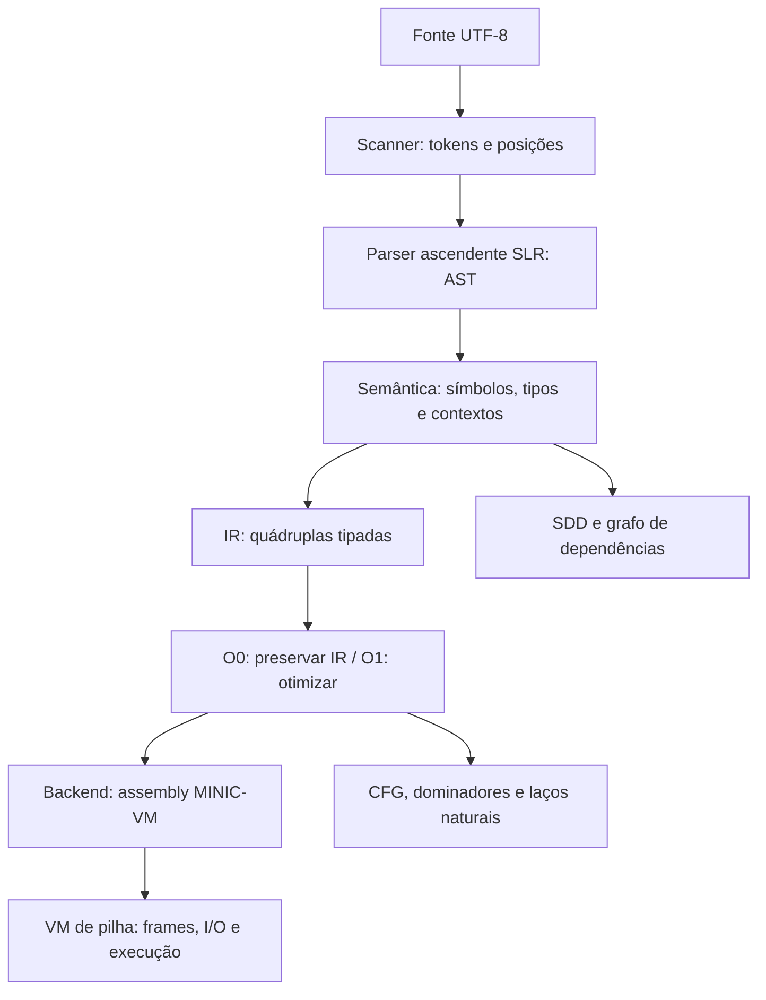

# Arquitetura do nosso compilador

Implementamos as fases em C e Python, usando a mesma gramática e os mesmos contratos. A versão C é nativa: não chama Python para compilar nem executar. Usamos Python nos verificadores automatizados e na geração das tabelas, que já estão versionadas. A versão Python usa somente a biblioteca padrão.



## Contratos entre os módulos

| Módulo | Entrada | Saída / responsabilidade |
|---|---|---|
| `src/lexer` | Caracteres | Fontes originais da etapa 1, preservados |
| `src/scanner` | Fonte | Tokens com kind, lexema, linha, coluna e intervalo |
| `src/parser` | Tokens | AST; driver SLR com pilha e ACTION/GOTO |
| `src/semantico` | AST e fonte | Árvore anotada e diagnósticos acumulados |
| `src/ir/gerador` | AST aceita | Quádruplas; consulta os símbolos já resolvidos |
| `src/ir/atributos` | AST anotada e intervalos da IR | Símbolos, atributos, grafo e ordem topológica |
| `src/optimizer` | IR | Propagação, CSE, liveness, CFG e dominadores |
| `src/codegen` | IR aprovada | Assembly de pilha e máquina virtual |
| `src/driver` | Opções e arquivo | Coordena as fases; impede geração após erro |

Geramos as tabelas SLR com `python tools/gerar_parser_lr.py`. São **146 estados e 87 produções**, incluindo a produção inicial. O único conflito previsto é o dangling else, resolvido por shift para associar `else` ao `if` mais próximo. Um conflito diferente interrompe a geração. `--check` no gerador confere que os arquivos versionados estão atualizados. A gramática numerada está em [gramatica.bnf](gramatica.bnf).

Nas opções finais, o parser tenta recuperar erros inserindo um `;` esperado ou sincronizando em `;`/`}` com descarte de estados e tokens. Registramos até 10 diagnósticos sintáticos; uma árvore recuperada não segue para semântica ou geração. A interface anterior interrompe no primeiro erro, como antes.

## IR e armazenamento

Cada instrução é uma quádrupla `(op, destino, a, b)`, com uma anotação adicional de tipo. A serialização usa cinco campos separados por TAB; `-` indica campo ausente. Literais mantêm aspas/escapes, e tabulações dentro de texto são escapadas. Temporários (`t1`, `t2`) e rótulos (`L1`, `L2`) são locais à função.

```text
FUNC    main          -             -     int
LOCAL   v2_9_x        -             -     int
ADD     t1            2             3     int
MOV     v2_9_x        t1            -     int
PRINT   -             v2_9_x        -     int
RETURN  -             0             -     int
END     main          -             -     void
```

O exemplo omite instruções auxiliares para facilitar a leitura. A execução real mantém cópias dos operandos quando necessário para preservar a ordem de avaliação e os efeitos das chamadas.

| Operações | Significado |
|---|---|
| `FUNC`, `ARG`, `END` | Procedimento, parâmetros e fim |
| `LOCAL`, `GLOBAL` | Declaração/alocação; `a` guarda tamanho de vetor |
| `MOV`, `CAST` | Atribuição e promoção explícita para float |
| `ADD`, `SUB`, `MUL`, `DIV`, `MOD`, `NEG`, `NOT` | Operações escalares |
| `LT`, `LE`, `GT`, `GE`, `EQ`, `NE` | Comparações booleanas |
| `LOAD d, a, b` | `d = a[b]`, com verificação de limites |
| `STORE d, a, b` | `d[a] = b`, com verificação de limites |
| `LABEL`, `JUMP`, `JTRUE`, `JFALSE` | Fluxo explícito |
| `PARAM`, `CALL`, `RETURN` | Argumentos, chamada e retorno |
| `PRINT`, `READ` | Entrada/saída tipada |

Usamos endereços simbólicos com posição da declaração, como `v3_9_x` para um local e `g1_5_x` para uma global. Assim, nomes sombreados recebem armazenamento diferente. `--symbols` mostra categoria, tipo, nível léxico, posição, endereço, slot conceitual no frame, informação do inicializador e quantidade de referências. A coluna de inicialização descreve a declaração; a análise de inicialização definida do otimizador é separada e depende do fluxo.

Uma função interna `$init`, cujo nome não pode ser escrito como identificador MINIC, reserva e zera todas as globais antes de avaliar seus inicializadores na ordem do fonte. Ela executa antes de `main`. Mantivemos a coleta antecipada das assinaturas globais, permitindo chamadas a funções definidas depois e recursão mútua.

## Backend e convenção MINIC-VM

Escolhemos uma **máquina de pilha didática**, alternativa prevista na especificação. Não produzimos assembly de CPU nativa. O assembly `.mvm` começa com `.MINICVM<TAB>1`; suas instruções também usam cinco campos TAB. `--exec` recarrega esse arquivo sem refazer as análises do fonte.

Por exemplo, `ADD t1, a, b` vira `PUSH a; PUSH b; ADD; POP t1`. `LOAD` empilha base e índice; `STORE` empilha base, índice e valor. Os tipos continuam anotados. A pilha de operandos é separada dos frames de chamada.

1. Avaliamos argumentos da esquerda para a direita e preservamos seus valores.
2. `PARAM` vira `PUSH`; `CALL` retira os argumentos e abre um frame independente.
3. `ARG` associa os valores aos parâmetros; locais e temporários pertencem àquela ativação.
4. `RETVAL` devolve um valor; `RET` encerra uma função void. O chamador continua após `CALL`.
5. Escalares são passados por valor. Parâmetros vetor compartilham a referência ao vetor; escritas são observáveis pelo chamador e pelos aliases.

O interpretador C mantém as alocações internas em uma arena até o fim da execução, liberada por `context_free`. O retorno encerra o acesso ao frame; não prometemos reutilização imediata de toda memória física. Não há malloc/free acessível em MINIC.

## Decisões da linguagem e execução

- Exigimos `int main()` sem parâmetros nas opções finais. A chamada sem opções conserva o contrato da etapa semântica anterior, que aceita funções isoladas sem main.
- Usamos int com sinal de 64 bits; overflow é erro de execução. Literais fora do intervalo são erro semântico. A divisão inteira trunca para zero; o resto acompanha esse quociente.
- Usamos float como double finito. Rejeitamos NaN/infinito de entrada e resultados não finitos. Preservamos a ordem das operações de ponto flutuante e não aplicamos suas identidades algébricas no otimizador.
- Mantivemos a promoção implícita int → float. Não adotamos a conversão char → int recomendada opcionalmente pelo documento; bool e char continuam distintos dos números.
- Condições exigem bool. `&&`/`||` usam curto-circuito. Expressões e argumentos seguem ordem da esquerda para a direita; calcular o endereço de um destino de vetor precede avaliar o valor atribuído.
- Atribuições são comandos; a cadeia `a=b=3` continua aceita, conforme o caso semântico anterior 09. Não pode ser usada como valor de retorno/argumento/condição.
- Índices constantes fora dos limites são rejeitados. Índices dinâmicos são conferidos na VM, inclusive parâmetros vetor com tamanho real conhecido em execução. Endereços são medidos em células, não bytes.
- Globais começam em zero. Locais e elementos locais começam não inicializados; uma leitura antes de escrita gera erro. A declaração local é reiniciada a cada entrada no bloco.
- `print` escreve um valor e newline; bool usa `true/false`, float usa até 12 dígitos significativos, char imprime o caractere e texto mantém seus escapes. `read` consome tokens separados por espaço, de acordo com o tipo; bool aceita true/false/1/0. Números de entrada usam dígitos ASCII; float também aceita notação exponencial.
- Limitamos uma execução a 2.000.000 instruções VM, profundidade de chamada 256 e 1.000.000 células por vetor. Exceder os limites gera erro de execução. Esses limites são uma política da VM educacional.

## Opções e códigos de saída

As opções finais são `--tokens`, `--ast`, `--symbols`, `--check`, `--ir`, `--target=asm`, `--run`, `--exec`, `--sdd`, `--deps` e `--cfg`. Escolhemos uma saída por chamada. `-O0/-O1` seleciona o otimizador; `--trace-parser` registra o parsing em stderr; `-o arquivo` salva um artefato em UTF-8. Sem uma opção de saída, mas com outras opções, geramos IR.

| Status | Opções finais |
|---:|---|
| 0 | Sucesso de compilação |
| 1 | Uso ou leitura de arquivo inválidos |
| 2 | Erro léxico |
| 3 | Erro sintático |
| 4 | Erro semântico |
| 5 | Erro de geração ou gravação |
| 6 | Erro de execução da VM |

Em `--run`/`--exec`, um programa executado normalmente devolve `main() & 255`. Um main que retorna 6 também devolve 6; o diagnóstico em stderr distingue isso de uma falha da VM. A chamada simples da etapa 3 mantém sucesso 0 e rejeição 1. Um erro de compilação não emite IR/assembly e não abre o arquivo solicitado em `-o`; não apagamos um arquivo antigo que já pertença ao usuário.

`--sdd` e `--deps` descrevem a árvore e os intervalos da IR original, antes da otimização, mesmo se `-O1` for informado. `--cfg` descreve a IR do modo escolhido. Os comandos de teste e benchmark escrevem artefatos em `build`, sem alterar automaticamente os resultados em Markdown.
