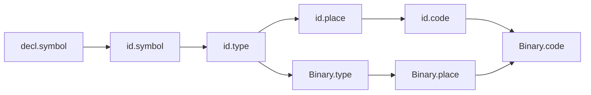

# Nossa definição dirigida por sintaxe

Separamos **SDD**, que especifica atributos e equações, de **SDT**, que executa ações numa ordem compatível com essas dependências. Seguimos a Aula 16: o parser pode sintetizar AST nas reduções LR, e os tipos/contextos podem ser calculados numa travessia posterior, antes de gerar código.

## Atributos e instâncias

| Atributo | Classe / origem | Implementação |
|---|---|---|
| `ast` | Sintetizado dos símbolos reconhecidos | Valor semântico da pilha SLR |
| `semantic_type` / `type` | Sintetizado após resolver nomes e verificar operandos | Campo da AST |
| `symbol` | Referência obtida do ambiente herdado | Símbolo persistente da declaração |
| `expected_type` | Herdado do destino, parâmetro ou retorno | Campo da expressão |
| `loop_depth` / `loop` | Herdado do contexto de controle | Campo da AST |
| `conversion_to` | Resultado da compatibilidade de tipos | Conversão explícita posterior |
| `array_size`, `assignable`, `flow` | Propriedades calculadas das declarações/comandos | Campos da AST |
| `place` | Sintetizado: literal, temporário ou endereço | Campo `ir_place` |
| `code` | Sintetizado: sequência de instruções | Intervalo `ir_begin:ir_end` na IR original |

Identificamos cada nó concreto como n0, n1 etc. `n3.type` e `n4.type` são instâncias distintas. Um `place` ausente aparece como `-`; um tamanho de vetor calculado apenas na compilação não precisa gerar código executável.

## Equações da construção de AST nas reduções

Usamos produções com precedência separada por não terminais, enumeradas em [gramatica.bnf](gramatica.bnf). As ações estão em `ascendente.py:reduce` e `ascendente.c.inc:lr_reduce`.

| Produção representativa | Equação / ação ao reduzir |
|---|---|
| `Sum → Sum₁ + Product` | `Sum.ast = Binary(+, Sum₁.ast, Product.ast)` |
| `Product → Product₁ * Unary` | `Product.ast = Binary(*, Product₁.ast, Unary.ast)` |
| `Unary → - Unary₁` | `Unary.ast = Unary(-, Unary₁.ast)` |
| `Expr → Or = Expr₁` | `Expr.ast = Assign(Or.ast, Expr₁.ast)` |
| `Declarator → IDENT = Expr` | `Declarator.ast = Decl(IDENT.lexeme, Expr.ast)` |
| `Decl → Type Declarators ;` | `d.type_name = Type.lexeme`, para cada declarador d |
| `Stmt → if ( Expr ) Stmt₁ else Stmt₂` | `Stmt.ast = If(Expr.ast, Stmt₁.ast, Stmt₂.ast)` |
| `Items → Items₁ Item` | `Items.ast = concat(Items₁.ast, Item.ast)` |

A construção de AST é S-atribuída: os valores necessários estão no lado direito reconhecido antes da redução. Não chamamos toda a análise semântica de S-atribuída; ela também precisa de ambientes e contextos herdados.

## Equações semânticas e de tradução

Usamos `Γ` para o ambiente, `concat` para concatenação ordenada e `newtemp/newlabel` para nomes novos. `emit` produz uma instrução, não escreve diretamente no terminal. Verificamos os tipos antes de executar a tradução.

```text
E → E1 op E2
    E1.Γ = E.Γ; E2.Γ = E.Γ
    E.type = tipoOperador(op, E1.type, E2.type)
    E.place = newtemp()
    E.code = E1.code || E2.code || emit(op, E.place, E1.place, E2.place)

E → literal
    E.type = tipoLiteral(literal)
    E.place = literal.lexeme
    E.code = []

E → id
    E.symbol = buscar(E.Γ, id.lexeme)
    E.type = E.symbol.type
    E.place = newtemp()
    E.code = emit(MOV, E.place, endereco(E.symbol))

E → E1 [ E2 ]
    E2.expected_type = int
    E.type = elemento(E1.type)
    E.place = newtemp()
    E.code = E1.code || E2.code || emit(LOAD, E.place, E1.place, E2.place)

S → destino = E
    E.expected_type = tipo(destino)
    S.type = void
    S.code = codigoEndereco(destino) || E.code || conversao(E) || store(destino, E.place)

S → while (E) S1
    E.expected_type = bool
    S1.loop = S.loop + 1
    S1.breakLabel = Lexit; S1.continueLabel = Ltest
    S.code = LABEL Ltest || E.code || JFALSE E.place,Lexit
             || S1.code || JUMP Ltest || LABEL Lexit

S → for (I; E; P) S1
    S1.loop = S.loop + 1
    S1.breakLabel = Lexit; S1.continueLabel = Lstep
    S.code = I.code || LABEL Ltest || E.code || JFALSE E.place,Lexit
             || S1.code || LABEL Lstep || P.code || JUMP Ltest || LABEL Lexit
```

O gerador inclui snapshots para manter os valores anteriores quando o próximo operando chama uma função com efeitos. `&&` e `||` usam equações com rótulos/condicionais, não concatenação incondicional do operando direito. A promoção int → float acrescenta `CAST` depois do código do filho; o `place` anotado identifica o valor convertido.

A coleta inicial das assinaturas globais precede a análise dos corpos. Propagamos o contexto de retorno e a profundidade de laço antes de visitar seus filhos. A tradução da AST aceita é um SDT manual em `gerador.py/.c`; não implementamos um motor genérico que interpreta equações arbitrárias de uma SDD.

## Grafo concreto e ordem de avaliação

`--deps` materializa instâncias de `symbol`, `type`, `loop`, `place` e `code`. Um vínculo de nome produz uma aresta da declaração para o uso. Operações incluem arestas dos tipos dos operandos para o tipo do resultado. O contexto de laço segue do pai para o filho; o código sintetizado segue dos filhos para o pai. Lexemas, a tabela global coletada e os geradores de nomes são entradas disponíveis.



`--sdd` lista os atributos calculados e uma ordem topológica do mesmo grafo. O verificador confere que toda dependência precede seu destino e compara a saída de C e Python. A ordem apresentada é uma ordem válida das dependências, não um histórico temporal das chamadas internas do compilador. O grafo explicita as dependências da tradução; não é o CFG de execução nem o grafo de fluxo de dados do otimizador.

Para reproduzir no VS Code:

```powershell
python minic.py --trace-parser --check examples/fatorial.c
python minic.py --sdd examples/fatorial.c
python minic.py --deps examples/fatorial.c -o build/dependencias.dot
```
