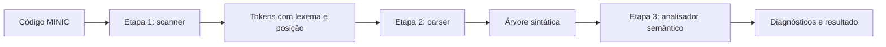

# Compilador MINIC — etapas 1, 2 e 3

Projeto da disciplina de Compiladores, com versões em Python e C. As três
etapas compõem um único frontend: o scanner fornece tokens, o parser constrói
uma árvore sintática (AST), e o analisador semântico verifica essa mesma árvore.

Integrantes: Ana Clara T. Coser, Beatriz Gabrielly Batista de Almeida e
Vinicius Henrique Santos.



## Organização

```text
Minic/
├── scanner.py / scanner.c     # entrada da etapa 1
├── parser.py / parser.c       # entrada da etapa 2
├── minic.py / minic.c         # entrada da etapa 3
├── Makefile
├── src/
│   ├── lexer/                # fontes originais da etapa 1, preservados
│   ├── scanner/              # adaptadores das mesmas regras da etapa 1
│   ├── parser/               # parser compartilhado entre etapas 2 e 3
│   ├── semantico/            # análise da AST, em C e Python
│   └── common.py / common.h / common.c
├── tools/gerar_scanner.py     # gera o scanner C a partir de lexer.l
├── testar_parser_python.sh   # testes sintáticos do projeto
├── testar_parser_c.sh
├── testes_semanticos_py.sh    # script original do professor
├── testes_semanticos_c.sh     # script original do professor
└── tests/
    ├── casos-invalidos/      # casos léxicos
    ├── casos-programas-c/    # casos léxicos
    ├── parser/              # 50 casos sintáticos fornecidos
    ├── semantico/           # 20 casos e gabaritos fornecidos
    ├── regressao/           # casos adicionais
    ├── scripts_professor/   # scripts originais de scanner e parser
    └── validar_compilador.py # valida as três etapas e C × Python
```

## Preparar e executar no VS Code

### Passo 1 — instalar as ferramentas

Usamos **Python 3.10 ou superior** e **GCC**. A versão Python não precisa de
bibliotecas extras.

No Windows, instale o [Python](https://www.python.org/downloads/windows/) e o
[MSYS2](https://www.msys2.org/). Mantenha a pasta padrão do MSYS2: `C:\msys64`.
Depois, abra **MSYS2 UCRT64** pelo menu Iniciar e execute:

```bash
pacman -S --needed mingw-w64-ucrt-x86_64-gcc diffutils
```

Esse comando instala o compilador C e a ferramenta que compara as saídas com
os gabaritos. O Bash e as demais ferramentas básicas vêm com o MSYS2.
Se já estiver tudo instalado, siga para o próximo passo.

### Passo 2 — abrir o projeto e o terminal

Abra a pasta `Ap1-Compiladores` no VS Code. Vá em **Terminal → Novo Terminal**
e escolha **PowerShell**. Entre na pasta do compilador:

```powershell
cd Minic
```

Execute os próximos comandos dentro de `Minic`. Se o terminal já estiver nessa
pasta, não precisa repetir `cd Minic`.

### Passo 3 — configurar os caminhos no terminal

No PowerShell, disponibilize o Python e as ferramentas do MSYS2:

```powershell
$env:Path = "$env:LOCALAPPDATA\Python\bin;C:\msys64\ucrt64\bin;C:\msys64\usr\bin;" + $env:Path
```

O caminho do Python acima corresponde à instalação pelo gerenciador Python
no Windows. Se sua instalação estiver em outra pasta, use o diretório que
contém o `python.exe`. Para localizar a instalação, execute
`py -c "import sys; print(sys.executable)"`.

Esse ajuste vale apenas para o terminal atual. Repita-o ao abrir outro terminal.

### Passo 4 — conferir as ferramentas

```powershell
python --version
python3 --version
gcc --version
bash --version
bash -c "diff --version"
```

Todos devem mostrar suas versões. Os scripts do professor usam o comando
`python3`, por isso conferimos também esse nome. Se aparecer a mensagem da
Microsoft Store, confira se a instalação real do Python vem antes de
`Microsoft\WindowsApps` no PATH.

### Passo 5 — compilar, se for executar C manualmente

```powershell
gcc -std=c11 -Wall -Wextra scanner.c -o scanner
gcc -std=c11 -Wall -Wextra parser.c -o parser
gcc -std=c11 -Wall -Wextra minic.c -o minic
```

Os scripts de testes e o verificador completo compilam os programas C
automaticamente. Esse passo é necessário para os exemplos individuais em C.

No Linux, usamos as mesmas ferramentas e executamos os binários com `./scanner`,
`./parser` e `./minic`. O ajuste de PATH em PowerShell é específico do Windows.

## Etapa 1 — analisador léxico (scanner)

**O que fizemos:** criamos o scanner em Python e C. Ele lê o código e identifica
os tokens, como palavras reservadas, nomes de variáveis, números e operadores.
Também informa a linha e a coluna de cada token e aponta erros léxicos.

Por exemplo, em `int idade = 20;`, ele identifica `int`, `idade`, `=`, `20` e `;`.
Preservamos os arquivos originais dessa etapa e criamos as entradas `scanner.py`
e `scanner.c` para executá-los com saída consistente no terminal.

### Passo 1 — escolher um arquivo para analisar

Neste exemplo, usamos `tests/casos-programas-c/c01_fibonacci.c`.
Você pode substituir esse caminho pelo seu arquivo MINIC.

### Passo 2 — executar na versão escolhida

**Python:**

```powershell
python scanner.py tests/casos-programas-c/c01_fibonacci.c
```

**C:** depois da compilação indicada na preparação:

```powershell
.\scanner.exe tests/casos-programas-c/c01_fibonacci.c
```

### Passo 3 — conferir o resultado

O terminal mostra os tokens encontrados, um por linha, no formato JSON.
Se houver um erro léxico, ele também será informado.

## Etapa 2 — analisador sintático (parser)

**O que fizemos:** construímos o parser para usar os tokens da etapa 1 e verificar
se o código segue a gramática do MINIC. Quando a sintaxe está correta, ele monta
uma árvore sintática (AST), que representa a estrutura do programa.

**Corrigimos a versão entregue anteriormente:** ajustamos a leitura dos tokens,
o reconhecimento de declarações, vetores, funções e expressões, a construção
da árvore e o tratamento de erros. Integramos as versões Python e C à etapa 1
e incluímos `break` e `continue`, conforme o conteúdo da análise semântica.

### Passo 1 — escolher um arquivo para analisar

Neste exemplo, usamos `tests/parser/casos/25_programa_integrado/codigo.c`.

### Passo 2 — executar na versão escolhida

**Python:**

```powershell
python parser.py tests/parser/casos/25_programa_integrado/codigo.c
```

**C:** depois da compilação indicada na preparação:

```powershell
.\parser.exe tests/parser/casos/25_programa_integrado/codigo.c
```

A chamada exigida pelo professor em Bash/Linux é `./parser codigo.c`.

### Passo 3 — conferir o resultado

Se a sintaxe estiver correta, o terminal mostra a árvore do programa.
Se houver um erro léxico ou sintático, mostra o erro e não imprime uma árvore
incompleta.

### Passo 4 — executar os testes sintáticos

```powershell
bash testar_parser_python.sh tests/parser parser.py
bash testar_parser_c.sh tests/parser parser.c
```

Esperamos **50/50**, com a ressalva indicada para o parêntese excedente no
**gabarito do caso 24**. Usamos scripts do projeto que conferem aceitação,
rejeição e estrutura da AST. Preservamos os scripts originais do professor
em `tests/scripts_professor` para consulta.

## Etapa 3 — analisador semântico

**O que fizemos:** desenvolvemos o analisador semântico em Python e C.
Ele usa a árvore da etapa 2 para verificar se o programa faz sentido segundo
as regras do MINIC. Implementamos as seguintes verificações:

- Uso de variáveis declaradas e nomes repetidos no mesmo escopo.
- Compatibilidade dos tipos e promoção permitida de `int` para `float`.
- Uso de vetores, índices inteiros e limites de índices constantes.
- Condições booleanas em `if` e `while`.
- Uso de `break` e `continue` dentro de laços.
- Quantidade e tipos dos argumentos das funções e os retornos necessários.

Também guardamos na AST os tipos, os símbolos resolvidos, as conversões e os
contextos necessários para a próxima etapa do compilador.

### Passo 1 — escolher um arquivo para analisar

Neste exemplo, usamos `tests/semantico/04_vetores_e_parametro_array.c`.

### Passo 2 — executar na versão escolhida

**Python:**

```powershell
python minic.py tests/semantico/04_vetores_e_parametro_array.c
```

**C:** depois da compilação indicada na preparação:

```powershell
.\minic.exe tests/semantico/04_vetores_e_parametro_array.c
```

### Passo 3 — conferir o resultado

Quando o programa é aceito, aparece:

```text
Análise semântica concluída: 0 erros; programa aceito.
```

Quando há erros semânticos, o terminal mostra os códigos dos erros, suas
posições no arquivo e a quantidade de erros encontrados.

### Passo 4 — executar os scripts do professor

No mesmo PowerShell, execute um comando por vez:

```powershell
bash testes_semanticos_py.sh minic.py tests/semantico
```

```powershell
bash testes_semanticos_c.sh minic.c tests/semantico
```

Esperamos, ao final de cada script:

```text
Resultado: 20/20 aprovados; 0 reprovados.
```

Alguns arquivos contêm erros de propósito. O teste passa quando o analisador
aponta exatamente os erros previstos no gabarito.

Em Bash, também podemos usar diretamente os comandos exigidos pelo professor:

```bash
./testes_semanticos_py.sh minic.py tests/semantico
./testes_semanticos_c.sh minic.c tests/semantico
```

## Testar o projeto completo no VS Code

### Passo 1 — executar o verificador

Com as ferramentas disponíveis e o terminal dentro de `Minic`, execute:

```powershell
python tests/validar_compilador.py
```

Ele compila os programas C e verifica as três etapas, os scripts de testes,
as regressões e as anotações da AST, comparando as versões Python e C.

### Passo 2 — conferir os resultados

Esperamos:

- Etapa 1: **10/10** em Python e C, considerando os arquivos disponíveis.
- Etapa 2: **25/25 válidos aceitos** e **25/25 inválidos rejeitados**.
- Etapa 3: **20/20** em Python e C.
- Testes adicionais: **62/62**, com resultados equivalentes entre as versões.
- AST anotada: tipos, símbolos, conversões e contextos conferidos em C e Python.

A observação do **caso 24** é uma diferença no gabarito original. O aviso do
**i06** informa que seu arquivo de entrada não foi fornecido. Mantivemos essas
ressalvas visíveis e preservamos os arquivos originais.

### Passo 3 — confirmar o encerramento

Logo depois do verificador, execute no PowerShell:

```powershell
$LASTEXITCODE
```

Esperamos **`0`**, sem `Traceback` ou `[FALHA]` na execução.
Se aparecer `WinError 4551`, o Windows bloqueou um executável por uma política
de segurança; a parte bloqueada ainda não foi testada. Consulte o controle de
aplicativos do Windows para identificar a restrição.

Os testes salvam arquivos locais em `Minic/build`. Não atualizam
`RESULTADOS_TESTES.md` e não enviam mudanças ao GitHub automaticamente.

Registramos os resultados em [Resultados dos testes](Minic/RESULTADOS_TESTES.md).
As decisões da linguagem estão em [Regras do MINIC](Minic/REGRAS_MINIC.md).
