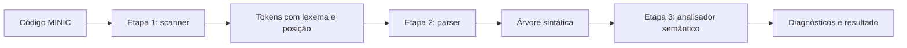

# Compilador MINIC — etapas 1, 2 e 3

Projeto da disciplina de Compiladores, com versões em Python e C. As três
etapas compõem um único frontend: o scanner fornece tokens, o parser constrói
uma árvore sintática (AST), e o analisador semântico verifica essa mesma árvore.

Integrantes: Ana Clara T. Coser, Beatriz Gabrielly Batista de Almeida e
Vinicius Henrique Santos.



## Organização

```text
Minic/
├── parser.py / parser.c       # entrada da etapa 2
├── minic.py / minic.c         # entrada da etapa 3
├── Makefile
├── src/
│   ├── lexer/                # fontes originais da etapa 1, preservados
│   ├── scanner/              # adaptadores das mesmas regras da etapa 1
│   ├── parser/               # parser compartilhado entre etapas 2 e 3
│   ├── semantico/            # análise da AST, em C e Python
│   └── common.py / common.h / common.c
├── tools/gerar_scanner.py     # gera o scanner C a partir de lexer.l
├── testes_semanticos_py.sh    # script original do professor
├── testes_semanticos_c.sh     # script original do professor
└── tests/
    ├── casos-invalidos/      # fixtures léxicos
    ├── casos-programas-c/    # fixtures léxicos
    ├── parser/              # 50 casos sintáticos fornecidos
    ├── semantico/           # 20 casos e gabaritos fornecidos
    ├── regressao/           # casos adicionais
    └── validar_compilador.py # valida as três etapas e C × Python
```

## Preparar e executar

### Passo 1 — conferir as ferramentas

Para usar a versão Python, instale o **Python 3**. Ela não precisa de bibliotecas
extras. Para usar a versão C, instale também o **GCC**.

No Windows, abra o terminal **Git Bash** no VS Code para executar os comandos
abaixo e os scripts de testes do professor. O GCC precisa estar disponível
nesse terminal.

Confira a instalação da versão que você vai usar:

```bash
python --version
gcc --version
```

### Passo 2 — entrar na pasta do projeto

Abra a pasta `Ap1-Compiladores` no VS Code. No terminal, entre na pasta `Minic`:

```bash
cd Minic
```

Execute todos os próximos comandos dentro dessa pasta.

### Passo 3 — compilar, se for usar C

Compile os programas das etapas 2 e 3:

```bash
gcc -std=c11 -Wall -Wextra parser.c -o parser
gcc -std=c11 -Wall -Wextra minic.c -o minic
```

Se for usar Python, pode seguir direto para a etapa desejada.

## Etapa 1 — analisador léxico (scanner)

**O que fizemos:** criamos o scanner em Python e C. Ele lê o código e identifica
os tokens, como palavras reservadas, nomes de variáveis, números e operadores.
Também informa a linha e a coluna de cada token e aponta erros léxicos.

Por exemplo, em `int idade = 20;`, ele identifica `int`, `idade`, `=`, `20` e `;`.
Preservamos os arquivos originais dessa etapa.

### Passo 1 — escolher um arquivo para analisar

Neste exemplo, vamos usar `tests/casos-programas-c/c01_fibonacci.c`.
Você pode substituir esse caminho pelo arquivo MINIC que quiser analisar.

### Passo 2 — executar na versão escolhida

**Python:**

```bash
python src/lexer/lexer.py tests/casos-programas-c/c01_fibonacci.c
```

**C:** compile o scanner e depois execute:

```bash
gcc -std=c11 -D_POSIX_C_SOURCE=200809L src/lexer/lexer.c -o lexer
./lexer tests/casos-programas-c/c01_fibonacci.c
```

### Passo 3 — conferir o resultado

O terminal mostra os tokens encontrados, um por linha, no formato JSON.
Se houver um erro léxico, ele também será informado.

## Etapa 2 — analisador sintático (parser)

**O que fizemos:** construímos o parser para usar os tokens da etapa 1 e verificar
se o código segue a gramática do MINIC. Quando a sintaxe está correta, ele monta
uma árvore sintática (AST), que representa a estrutura do programa.

**Corrigimos a versão entregue anteriormente:** ajustamos a leitura dos tokens,
o reconhecimento de declarações, vetores, funções e expressões, a construção
da árvore e o tratamento de erros. Integramos as versões Python e C
à etapa 1 e validamos seu funcionamento com os testes sintáticos do professor.

### Passo 1 — escolher um arquivo para analisar

Neste exemplo, vamos usar `tests/parser/casos/25_programa_integrado/codigo.c`.

### Passo 2 — executar na versão escolhida

**Python:**

```bash
python parser.py tests/parser/casos/25_programa_integrado/codigo.c
```

**C:** depois da compilação indicada na preparação:

```bash
./parser tests/parser/casos/25_programa_integrado/codigo.c
```

### Passo 3 — conferir o resultado

Se a sintaxe estiver correta, o terminal mostra a árvore do programa.
Se houver um erro léxico ou sintático, mostra o erro e não imprime uma árvore
incompleta.

## Etapa 3 — analisador semântico

**O que fizemos:** desenvolvemos o analisador semântico em Python e C.
Ele usa a árvore da etapa 2 para verificar se o programa faz sentido segundo
as regras do MINIC. Implementamos as seguintes verificações:

- Uso de variáveis declaradas e nomes repetidos no mesmo escopo.
- Compatibilidade dos tipos em atribuições, operações e chamadas de funções.
- Uso de vetores e índices inteiros.
- Condições booleanas em `if` e `while`.
- Quantidade e tipos dos argumentos das funções e os retornos necessários.

Por exemplo, usar uma variável que não foi declarada gera um erro semântico,
mesmo que a escrita da expressão esteja sintaticamente correta.

### Passo 1 — escolher um arquivo para analisar

Neste exemplo, vamos usar `tests/semantico/04_vetores_e_parametro_array.c`.

### Passo 2 — executar na versão escolhida

**Python:**

```bash
python minic.py tests/semantico/04_vetores_e_parametro_array.c
```

**C:** depois da compilação indicada na preparação:

```bash
./minic tests/semantico/04_vetores_e_parametro_array.c
```

### Passo 3 — conferir o resultado

Quando o programa é aceito, aparece:

```text
Análise semântica concluída: 0 erros; programa aceito.
```

Quando há erros semânticos, o terminal mostra os códigos dos erros, suas
posições no arquivo e a quantidade de erros encontrados.

### Passo 4 — rodar os testes do professor

Para testar todos os arquivos da pasta `tests/semantico`, use o script
correspondente à versão escolhida:

**Python:**

```bash
./testes_semanticos_py.sh minic.py tests/semantico
```

**C:**

```bash
./testes_semanticos_c.sh minic.c tests/semantico
```

Os scripts comparam as saídas com os gabaritos e mostram quais testes passaram.
Registramos os resultados em [Resultados dos testes](Minic/RESULTADOS_TESTES.md).
